# HomeServe Pro — Flutter Home Services Marketplace Demo

HomeServe Pro is a demo home services marketplace built with **Flutter and Dart**. It provides an interactive, responsive interface for customers, service workers, and administrators to explore the main workflows of a home services platform.

## Screenshots

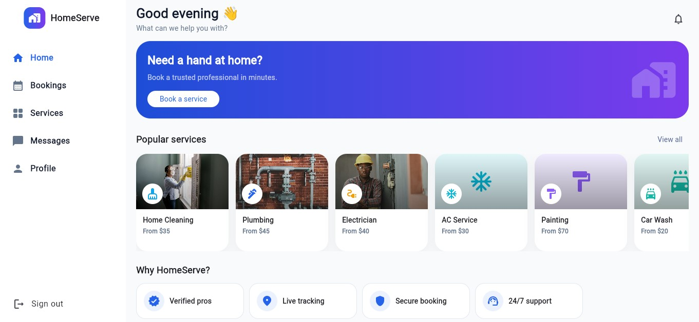

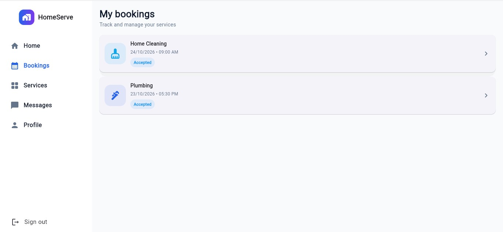

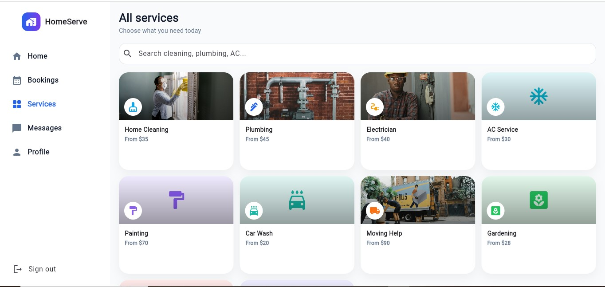

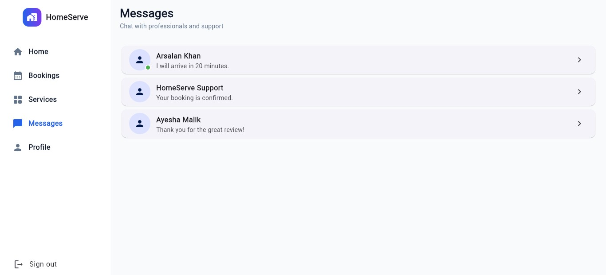

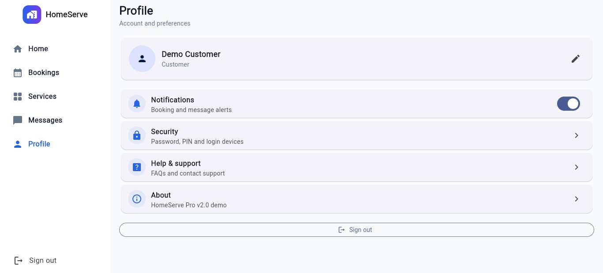

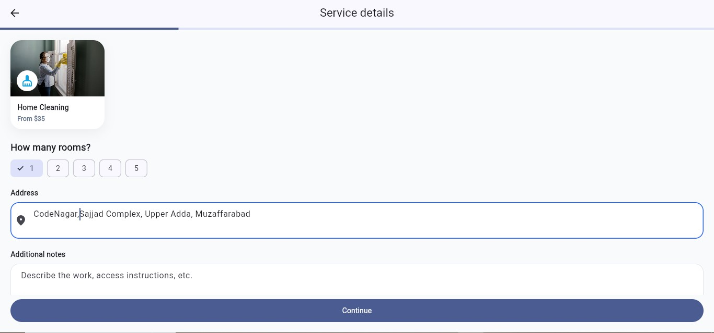

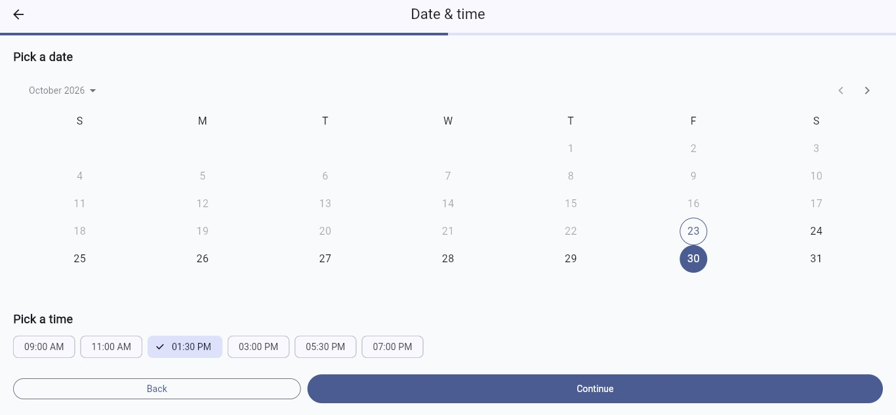

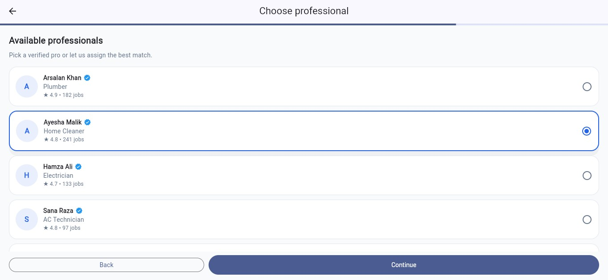

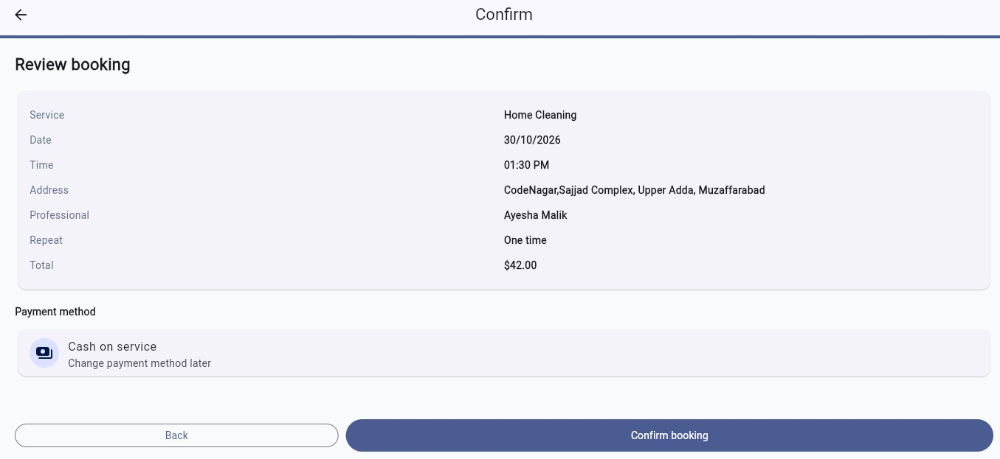

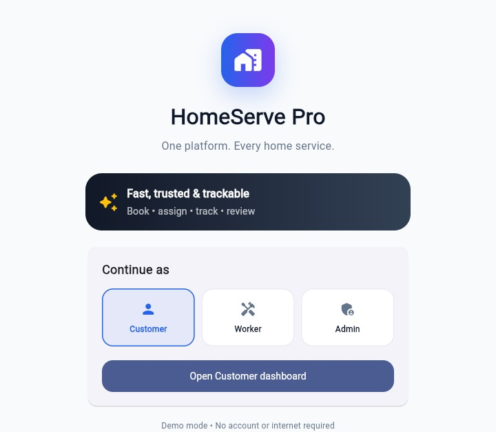

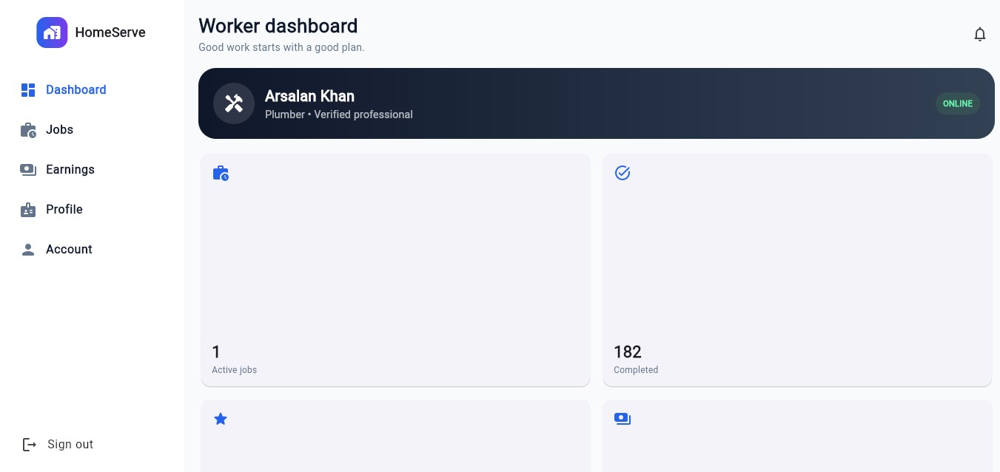

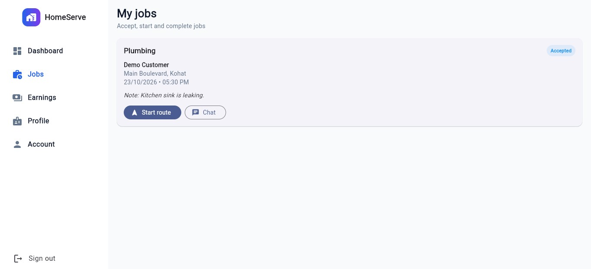

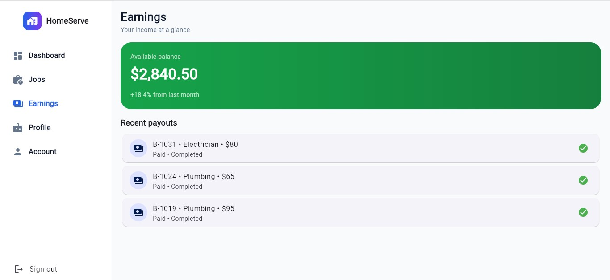

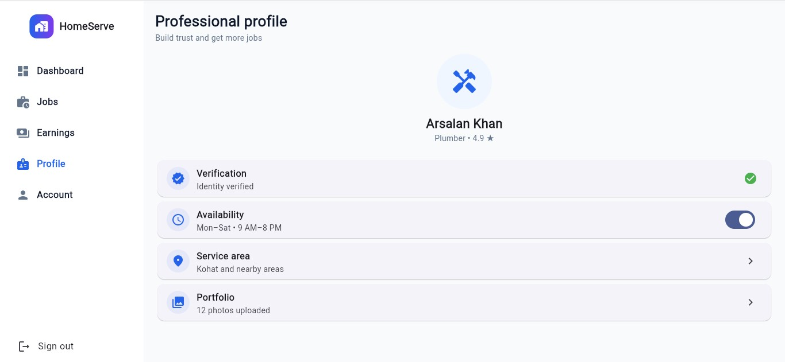

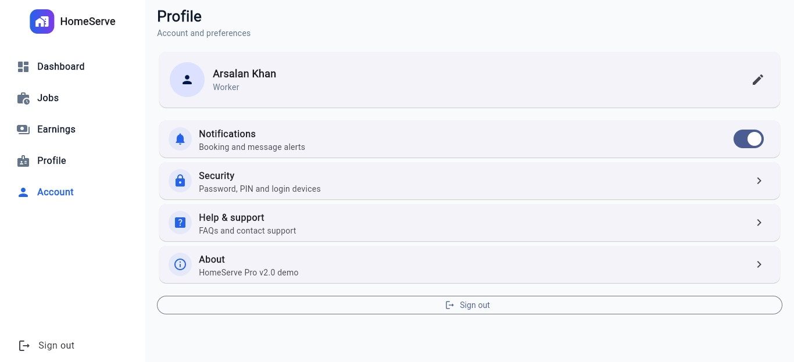

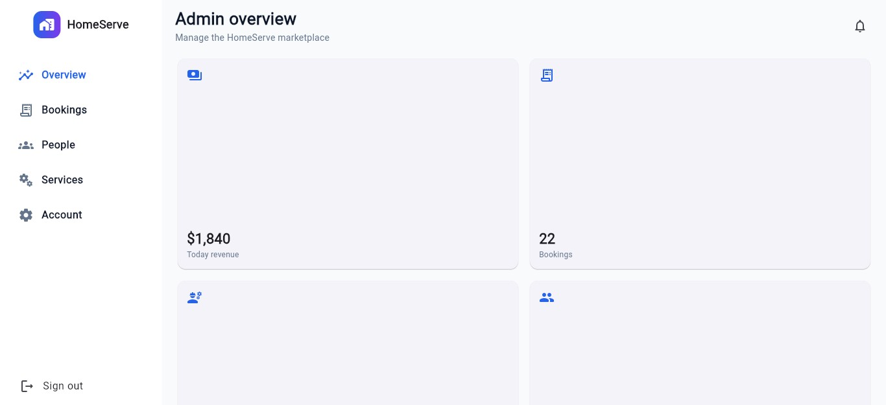

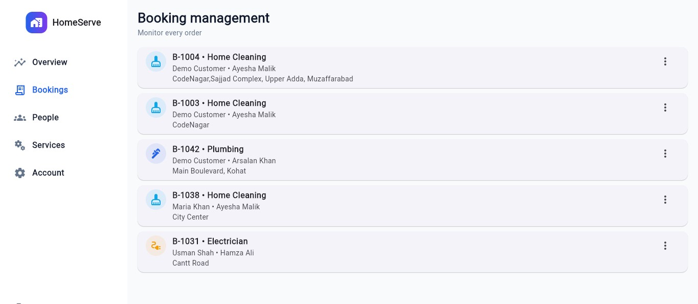

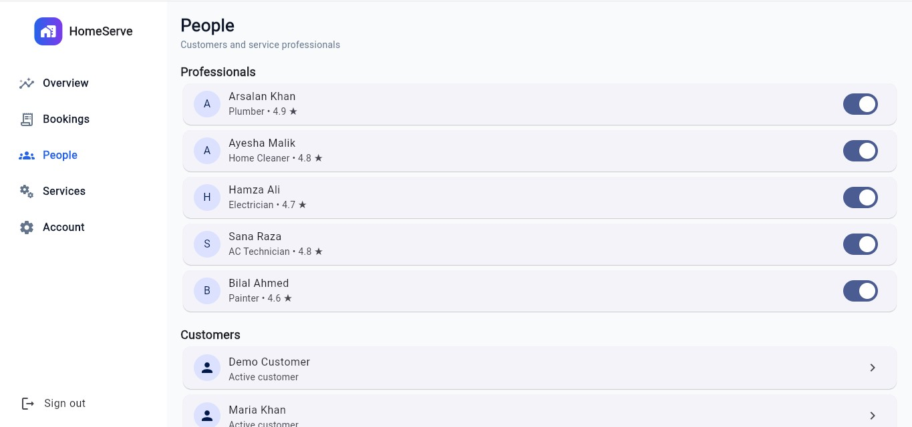

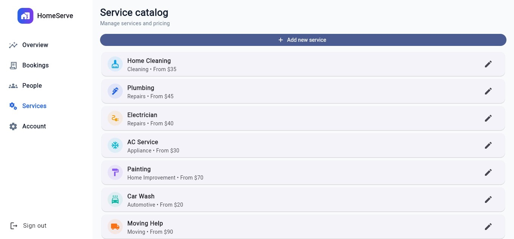

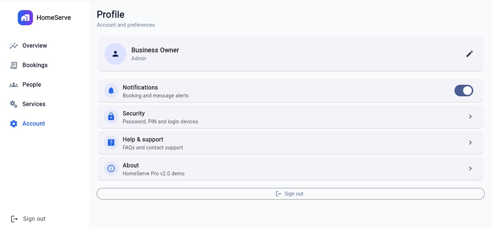


## Features

### Customer
- Discover available home services.
- Browse and choose service professionals.
- Schedule and repeat bookings.
- Track jobs and manage booking history.
- Access messaging and profile features.

### Worker
- View a worker dashboard and manage availability.
- Receive and manage incoming jobs.
- Accept, start, and complete jobs.
- Track earnings and manage profile information.
- Chat with customers.

### Admin / Business Owner
- View marketplace statistics, revenue, and KPI cards.
- Approve service workers.
- Manage customers and workers.
- Manage bookings and the service catalog.

## Getting Started

### Prerequisites
- Flutter SDK installed and configured.
- Google Chrome installed for running the web version.

### Run the Project

Clone the repository and navigate to the project directory:

```bash
git clone https://github.com/ahmedbutt09/flutter-home-service-app.git
cd flutter-home-service-app
```

Install dependencies and run the application:

```bash
flutter clean
flutter pub get
flutter run -d chrome
```

## Technical Highlights

- Material 3 interface.
- Responsive layouts for desktop, tablet, and mobile.
- Animated page transitions.
- Animated hero booking card and logo transition.
- Booking confirmation animation.
- Local fallback icons when service images cannot load.
- Scrollable layouts and `Wrap`-based chips to help prevent small-screen overflows.

## Demo Data

The application intentionally uses **local in-memory demo data**. Its interface and demo workflows can run without Firebase credentials or a separate API server. Data is not intended to persist permanently and may reset when the application restarts.

## Production Backend

For a production deployment, connect the repository and data layers to Firebase Authentication and Cloud Firestore, or to a custom backend API.

Authentication, persistent storage, role-based authorization, and server-side validation must be implemented and configured before the application is used with real customers or workers.

Useful resource: [FlutterFire Documentation](https://firebase.flutter.dev/)

## Limitations

This project is an **interactive front-end demonstration**, not a production-ready marketplace. The following capabilities require additional backend services, credentials, or platform configuration:

- Real payments and payment processing.
- SMS and OTP verification.
- Push notifications.
- Maps and GPS integration.
- Background location tracking.
- Cloud data persistence.
- Worker identity verification.
- Production authentication and security rules.

## Project Purpose

This project demonstrates Flutter application development, responsive UI design, role-based interfaces, and home service booking workflows. It is intended for learning, demonstration, and portfolio purposes.

## License

This project is available for demonstration and educational purposes. Add a specific open-source license if you intend to permit reuse or redistribution under defined terms.
